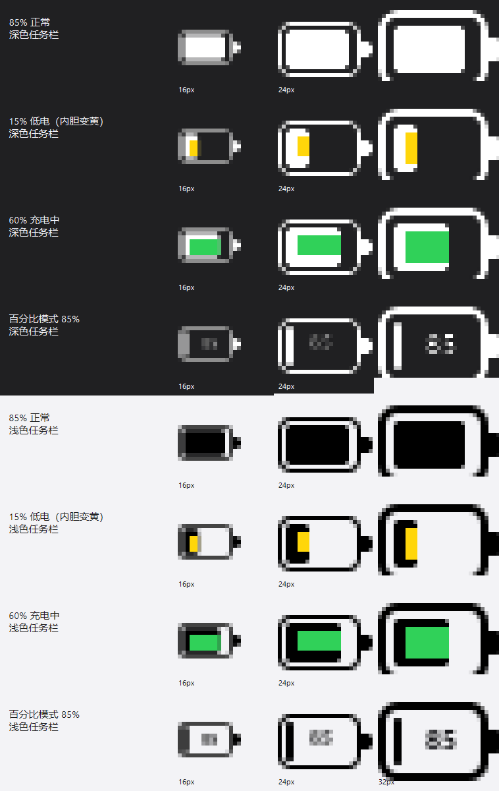
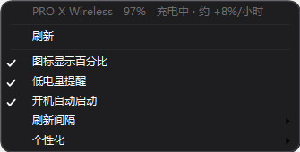
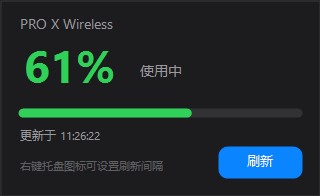

# LogiBatteryTray

在 Windows 任务栏显示罗技无线鼠标电量的托盘小工具。

直接通过罗技 **HID++ 2.0** 协议读取电量，**不需要** Logitech G HUB / Options+ 常驻后台。



## 功能

- 托盘图标使用 Windows 原生电池资源（`batmeter.dll.mun`）的雪碧图，外观与系统电池一致
- 电量分 10 档显示；**低于 20% 内胆变黄、描边保持白色**
- 充电时内胆变绿，并在菜单/面板显示估算充电速率（如 `约 +8%/小时`）
- 鼠标休眠时保留上次读数并显示“休眠”，移动鼠标自动刷新
- 右键菜单可调刷新间隔、开机启动、图标显示百分比、低电量提醒
- 「个性化」子菜单：主题（跟随系统/深色/浅色）、菜单不透明度、圆角
- 低于 20% 时发送 Windows 通知（进入通知中心，3 小时内不重复）
- 支持 Unifying / Lightspeed 接收器，以及插线直连模式
- 高 DPI 适配，浅色/深色任务栏自适应

| 右键菜单 | 详情面板 |
| --- | --- |
|  |  |

## 运行要求

- Windows 10 / 11（64 位）
- .NET 10 桌面运行时（若未安装会提示缺少运行时）

## 安装

1. 下载仓库中的 `dist` 文件夹（或自行构建），保持 `LogiBatteryTray.exe` 与同目录的 `.dll` / `.json` 在一起
2. 双击 `LogiBatteryTray.exe`
3. 新图标可能被收进任务栏的「隐藏的图标」（`^`），拖到任务栏上即可常驻

> 注意：不要从带有「低完整性」标签的目录运行（例如某些沙箱工作区），否则 Windows 会拒绝注册托盘图标，程序会退化为右下角悬浮小卡。

## 使用方法

- **左键**托盘图标：打开详情面板
- **右键**：刷新、刷新间隔、图标显示百分比、低电量提醒、开机自动启动、个性化、退出
- 勾选「开机自动启动」会写入当前用户的 `HKCU\Software\Microsoft\Windows\CurrentVersion\Run`

## 命令行

```text
LogiBatteryTray.exe --once              读取一次电量并打印
LogiBatteryTray.exe --features          枚举设备全部 HID++ 特性（排查用）
LogiBatteryTray.exe --dump 0x1004       查看某个特性的原始应答
LogiBatteryTray.exe --iconpreview a.png 生成图标预览
LogiBatteryTray.exe --popup-preview a.png  生成详情面板预览
```

## 常见问题

| 现象 | 说明 |
| --- | --- |
| 图标显示灰色、提示“休眠” | 鼠标省电休眠，移动一下即可自动刷新 |
| 提示“未检测到鼠标” | 确认接收器插好、鼠标开关在 ON；唤醒后 30 秒内会自动重连 |
| 插线充电后显示断开 | 正常：插线时接收器会从 USB 消失、鼠标切到直连模式，程序会在 30 秒内自动重新发现 |
| 托盘没有图标 | 可能运行在低完整性环境；把程序放到普通目录（如桌面）再运行 |

日志：`%APPDATA%\LogiBatteryTray\log.txt`（菜单「打开日志文件夹」可直接打开）。

## 技术说明

- 报文：HID++ 2.0 长报文（Report ID `0x11`，20 字节）
- Software ID 固定 `0x0B`，避开 G HUB（`0x0D`）与罗技固件（`0x0F`）
- 特性 ID 使用**大端序**
- 电量特性优先 `0x1004`（Unified Battery）：**功能 0 是能力位域，功能 1 才是 [百分比, 档位, 状态]**；其次 `0x1000` / `0x1001`
- 设备名：特性 `0x0005` 的**功能 1**
- 图标：从 `C:\Windows\System32\batmeter.dll.mun` 提取的雪碧图（24px / 32px），0–9 帧对应 0–100% 电量
- 通过 Raw Input 监听鼠标活动，唤醒后自动刷新

## 构建

```powershell
powershell -ExecutionPolicy Bypass -File .\build.ps1
```

产物在 `dist\`。

## 许可

MIT
